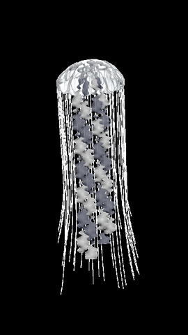
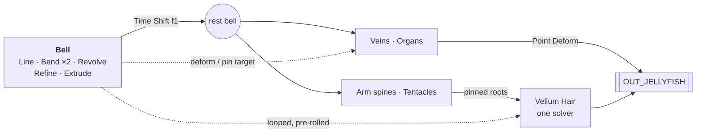
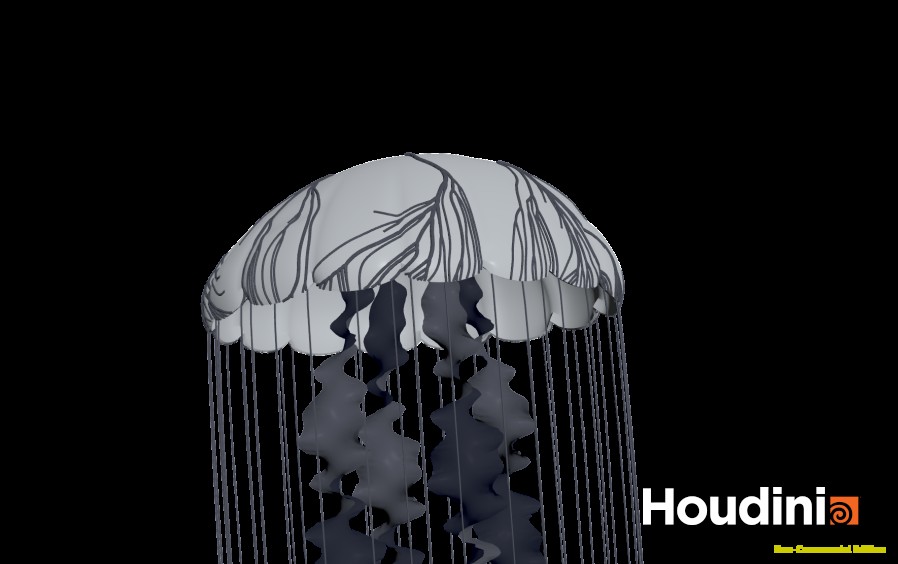
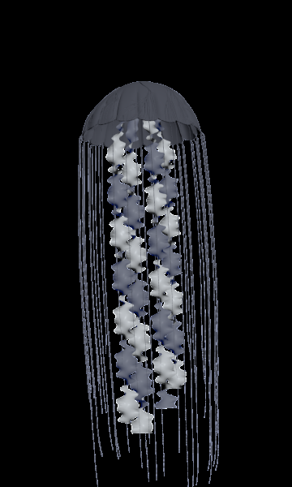
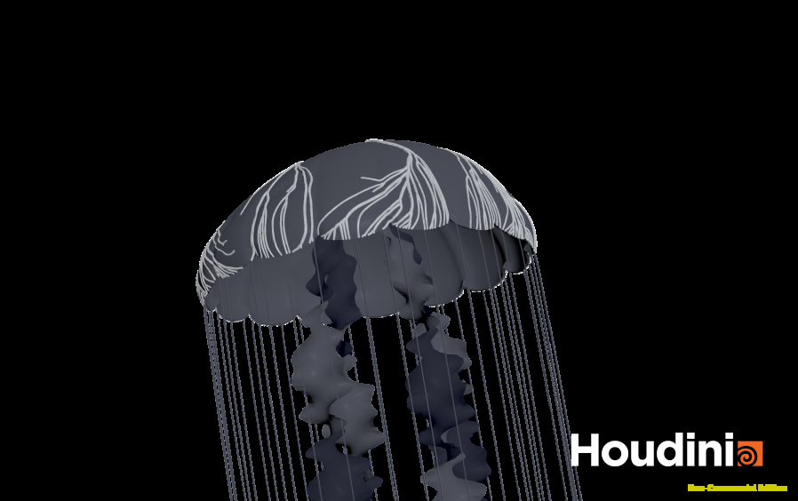
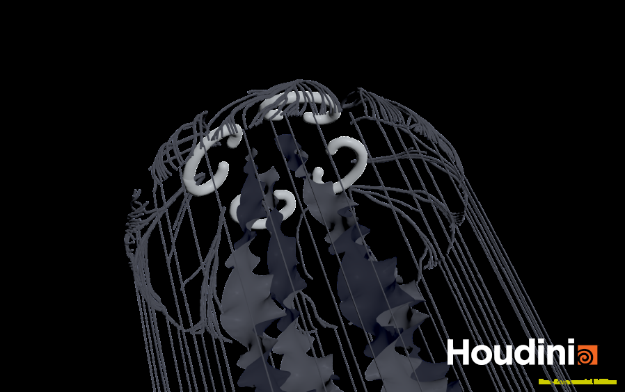
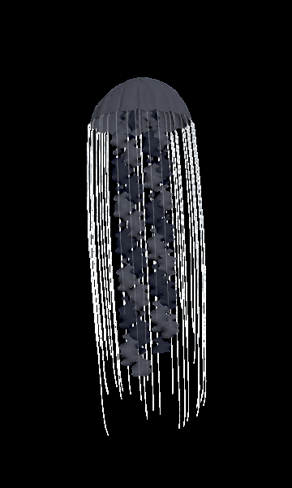
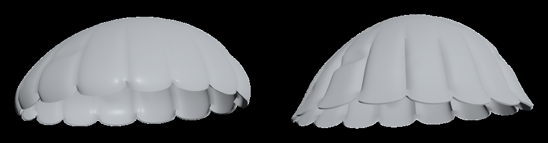
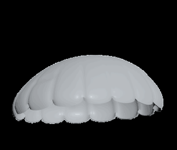

# Procedural Jellyfish

A swimming jellyfish built procedurally in Houdini (SOPs · VEX · Vellum). One animated bell drives everything: the veins and organs ride on it, and the oral arms and tentacles are simulated hanging from it.

<a href="media/jellyfish.mp4">▶ Full-resolution video (mp4)</a>

## How it fits together

Every part is built on the bell frozen at frame 1, then carried by the animated bell. Surface parts use **Point Deform**. Simulated parts are **pinned with Match Animation** and run in a single Vellum solver that pre-rolls one full swim cycle, so the animation loops seamlessly.

## Parts

<table>
<tr>
<td></td>
<td><b>Bell</b> A line bent twice and revolved into a dome, with noise and a thin extruded shell. Keyframed bend angles and height on a <code>CONTROLLER</code> null drive the pulse. Displayed translucent so the organs show through. <code>Line</code> · <code>Bend ×2</code> · <code>Revolve</code> · <code>Attribute Noise</code> · <code>Poly Extrude</code></td>
</tr>
<tr>
<td align="center"></td>
<td><b>Oral arms</b> A grid ruffled in VEX, twisted and remeshed, tapered where it leaves the mouth. Four copies flare out from the mouth and hang as long as the tentacles. Each arm follows a simulated Vellum spine that is softly pinned to its rest shape, and the mesh is bent along it in VEX. <code>Grid</code> · <code>Wrangle</code> · <code>Bend (twist)</code> · <code>Remesh</code> · <code>Copy to Points</code> · <code>Vellum Hair</code></td>
</tr>
<tr>
<td></td>
<td><b>Veins</b> Shortest paths on the remeshed bell, from roots near the crown to tips on the rim and mid-bell. A vertically stretched noise cost makes them wander and share trunks, which become thicker where more paths overlap. <code>Remesh</code> · <code>Find Shortest Path</code> · <code>Fuse</code> · <code>Polypath</code> · <code>Resample</code> · <code>Smooth</code> · <code>Sweep</code> · <code>Point Deform</code></td>
</tr>
<tr>
<td></td>
<td><b>Organs</b> Four wobbly horseshoe curves generated in VEX, opening toward the center. They are dropped onto the underside of the crown and swept into tubes with rounded ends. <code>Wrangle</code> · <code>Sweep</code> · <code>Point Deform</code></td>
</tr>
<tr>
<td align="center"></td>
<td><b>Tentacles</b> 40 thin curves (2.25–3.75 long) hung from the rim, with roots snapped exactly onto the moving rim. Vellum Hair with low gravity and strong drag to feel like water, and the bell as a collider. <code>Wrangle</code> · <code>Vellum Hair</code> · <code>Vellum Solver</code> · <code>Sweep</code></td>
</tr>
</table>

## Extra Credit: Refined bell

 relaxed (left) vs. contracted (right), and the pulse

One VEX pass after the revolve, placed in surface coordinates (angle around the axis, distance from the rim) so the details stick to the bell while it animates:

- **Scalloped margin**: 16 rounded lappets, made by lifting the rim between lobes with `1 - |sin(8θ)|^0.5`.
- **Pleats**: radial grooves running up from each notch. They deepen as the bell contracts by reading the same `bendMain` channel that drives the pulse.
- **Dents**: noise dimples sampled in a polar projection so they stay smooth at the crown.

Everything downstream (veins, organs, tentacles, the simulation's collider) picks up the new shape automatically.

## Gotchas

- Vellum writes hair thickness to `pscale`, and Sweep multiplies its radius by it. Turn off *Transform Using Curve Attributes*, or the tentacles all but vanish.
- To loop a simulation, cycle the bell with a Time Shift (`$FF - 139*floor(($FF-1)/139)`) and start the solver one cycle early, so frame 140 matches frame 1.
